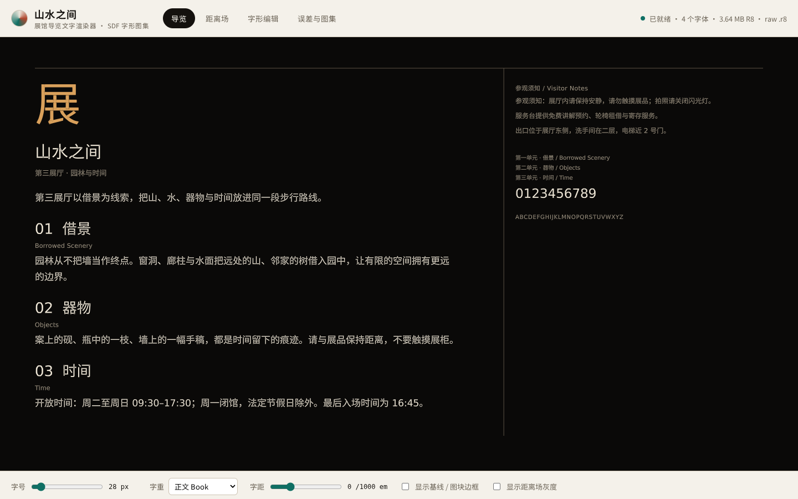

# 山水之间 · 展馆导览文字渲染器

一条完整的可缩放文字链路：**可分发字体 → 轮廓 → 有符号距离场 → R8 字形图集 →
GPU 实例化绘制**。界面里的每一个展馆文字都是图集里的实例，不使用浏览器 `text` 元素，
也不把低分辨率位图拉大冒充可缩放渲染。



## 快速开始

```bash
npm install
npm run fonts    # 校验内置字体哈希/许可证，重建界面 Web 字体
npm run atlas    # 生成距离场图集与清单
npm run dynamic  # 生成运行时按需字形源 web/atlas/dynamic-sources.json
npm run report   # 与精确轮廓光栅化比较，输出误差报告
npm run serve    # http://localhost:5173
```

打开页面后有五个视图：

| 视图 | 内容 |
|---|---|
| 导览 | 实际 GPU 渲染的展馆文字；字号、字重、字距、基线/图块引导线、距离场灰度；底部可输入固定图集之外的文字驱动动态图集 |
| 动态图集 | 有界运行时缓存实况：待生成 / 已上传可绘制 / 缺字占位 / 等待 GPU 回收，含显存范围与回收、销毁、重建 |
| 距离场 | 图块放大检查：原始 R8、有符号距离（零等值线）、阈值化字形，并附同字号重建条带 |
| 字形编辑 | 拖动控制点、横向/纵向缩放、描边偏移；内核实时重算距离场并回写固定或动态图集 |
| 误差与图集 | 读取 `docs/report/metrics.json`，呈现各字号/字体的 MAE、RMSE、IoU 与图集大小 |

## 设计要点

- **三个概念分开**：字形图形范围（墨迹包围盒 + 图块空白边）、排版前进量（字体度规，
  来自 `hmtx`/GPOS）、图集像素边距（`padTexels`，纯纹理安全区）。排版笔位只累加前进量，
  **图块贴图宽度从不参与字距**，测试 `test/layout.test.mjs` 直接断言这一点。
- **距离参数进入着色器**：`rangeTexels`、`texelsPerEm`、`pxPerEm` 是每实例属性，
  解码与屏幕像素换算在片元着色器内完成。
- **边缘约定明确**：固定 1 屏幕像素的 AA 斜坡，所有字号共用同一阈值；大倍率下场的采样
  带宽限制由报告逐字号量化，不靠替换阈值掩盖。
- **避免邻字污染**：构建时强制 `padTexels > rangeTexels`，图块边框饱和；片元着色器
  再次拒绝图块矩形外的采样。
- **颜色空间**：图集是 R8 线性距离数据，不做 sRGB 解码；文字颜色与覆盖度在 sRGB
  显示空间直通 alpha 混合。详见 [`docs/RENDER-CONTRACT.md`](docs/RENDER-CONTRACT.md)。
- **动态有界图集**：固定图集未覆盖的字符在运行时用同一 SDF 内核异步生成并上传到一张
  容量固定的 R8 纹理。在用字形被引用计数钉扎不可回收；槽位与身份带代次，迟到任务无法
  覆盖新分配；排版缓存随代次失效；缺字显示明确占位符而非残留像素；回收经 GL fence 在
  GPU 完成边界后清零，绝不只删 JS 引用，也不靠无限扩图。详见
  [`docs/GLYPH-ATLAS.md`](docs/GLYPH-ATLAS.md) 第 6 节。

## 误差与尺寸（当前构建）

| 项目 | 数值 |
|---|---|
| 图集 | 4 个字体，R8 共 **3.64 MB**，PNG 共 **576 KB** |
| 参数 | 64 texel/em，编码范围 ±10 texel，图块边距 16 texel |
| 全样本平均 MAE | **0.00202** |
| 按字号 IoU | 12 px 0.808 → 192 px 0.985 |
| 字形数 | 拉丁 107 × 3 字重，中文 164 |

逐字形、逐字号的完整表格见 [`docs/report/REPORT.md`](docs/report/REPORT.md)，
机器可读指标见 [`docs/report/metrics.json`](docs/report/metrics.json)。

## 命令

```bash
node tools/fetch-fonts.mjs          # 校验内置字体，重建界面 Web 字体
node tools/build-atlas.mjs          # 生成 web/atlas/* 固定图集
node tools/build-dynamic-sources.mjs # 生成运行时按需字形源（npm run dynamic）
node tools/compare-report.mjs       # 生成 docs/report/*
node tools/serve.mjs                # 静态服务器
node tools/build-ui-font.mjs        # 仅重建界面 Web 字体（需要 fontTools）
```

命令行只辅助生成与量测图集（含动态字形源）；运行时绘制、缓存与回收完全由 GPU、清单与
动态状态机驱动。

## 测试

```bash
npm test    # node --test：内核、排版不变量、误差上界、边框饱和、动态有界图集全生命周期
npm run e2e # Playwright：视图切换、编辑器回写与 PAD_BREACH 反馈
```

## 目录

```
assets/fonts/     内置可分发字体（DejaVu、Noto Sans SC，含许可证）
shared/           图集内核：几何、距离场、打包、排版、着色器、动态缓存/供给/排版
tools/            CLI：构建、报告、服务、字体校验、动态字形源生成
web/              界面与运行时渲染器（atlas/ 为构建产物，含 dynamic-sources.json）
docs/             入口文档、渲染契约、误差报告
test/             单元测试与 e2e
```

## 字体许可

DejaVu 系列为 Bitstream Vera 许可；Noto Sans SC 为 SIL OFL 1.1。
许可证文本随字体放在 `assets/fonts/`。界面 Web 字体由 Noto Sans SC 在 wght=400
实例化后按界面用字子集化（`tools/build-ui-font.mjs`）。
